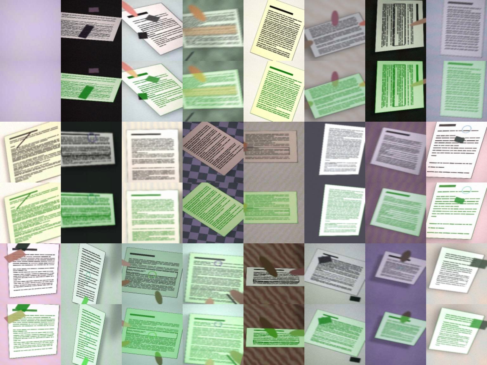

# pagequad — a tiny model that finds the sheet of paper in a photo

A 56,329-parameter U-Net that answers one question: **where is the sheet of paper in this photo?**
It outputs a probability mask; the four corners come from that mask with plain geometry. It is small enough
(220 KB of weights, ~12 M multiply-adds) to run in a web page or a phone WebView with a ~150-line dependency-free
JavaScript engine, which is included.

Everything here was made from scratch: the architecture, the **fully synthetic training data generator**, the training
script and the weights. No third-party dataset and no pretrained or third-party model weights were used.

> **Português (resumo):** modelo minúsculo que segmenta a folha de papel numa foto. Treinado só com imagens sintéticas
> geradas por `gen.py`. Inclui código de treino, pesos, um motor de inferência em JavaScript puro (`web/docnet.js`) e uma
> demo no navegador. Veja as limitações abaixo antes de confiar em fotos reais: **não foi avaliado em fotos reais.**



## What is in the box

| Path | What |
|---|---|
| `gen.py` | Synthetic scene generator (surfaces, paper content, perspective, shadows, fingers, objects, blur, noise, JPEG) |
| `model.py` | The network (depthwise-separable U-Net with a global-context add) |
| `train.py` | CPU training loop (BCE + Dice, AdamW, one-cycle LR) and the mask → corners step |
| `evaluate.py` | Held-out evaluation on fresh synthetic scenes |
| `export.py` | Folds BatchNorm and writes `web/docnet.json` + `web/docnet.bin` |
| `predict.py` | `python predict.py photo.jpg` → corners + overlay |
| `web/docnet.js` | Dependency-free JavaScript inference engine (matches PyTorch to ~5e-6) |
| `web/demo.html` | In-browser demo (serve the folder over HTTP) |
| `net.pt` | Trained PyTorch weights (state dict) |
| `web/docnet.{json,bin}` | Same weights for the web engine (float32, BatchNorm folded) |
| `results/` | `metrics.json`, validation curve, sample scenes |

## Use it

Python:

```bash
pip install -r requirements.txt
python predict.py photo.jpg                       # uses net.pt (PyTorch weights, included)
```

JavaScript:

```html
<script src="docnet.js"></script>
<script>
  await DocNet.load('docnet');                      // fetches docnet.json + docnet.bin
  // pix: RGBA (or RGB) bytes of the photo squashed to 128x128 (area interpolation, like in training)
  const prob = DocNet.run(pix, 4);                  // Float32Array(128*128), probability that a pixel is paper
</script>
```

The photo is **squashed to 128×128 without keeping the aspect ratio** (the same as in training); map the mask back by
stretching it. Threshold at 0.5, take the largest contour, and fit a quadrilateral (see `quad_from_mask` in `train.py`).

## Training

```bash
python train.py --steps 9000 --bs 32 --workers 6 --lr 3e-3 --out net.pt
python evaluate.py --weights net.pt --n 1000
python export.py net.pt web/docnet
```

Trained for 9,000 steps (batch 32) on a CPU, about 2.3 hours. Data is generated on the fly from a seed, so every step
sees new scenes. Validation (400 fixed held-out scenes, `results/val_curve.txt`):

| Step | Mask IoU | Corners within 4% |
|---:|---:|---:|
| 1000 | 0.970 | 60.6% |
| 3000 | 0.987 | 69.1% |
| 6000 | 0.990 | 71.4% |
| 9000 | 0.991 | 71.1% |

## Results

Held-out evaluation, 1,000 fresh synthetic scenes (`python evaluate.py`, `results/metrics.json`).
"Within X%" = mean corner distance as a fraction of the frame diagonal.

| | Within 2% | Within 4% | Within 8% | Scenes |
|---|---:|---:|---:|---:|
| **Whole sheet inside the photo** | **97.0%** | **98.5%** | **99.3%** | 135 |
| Sheet cut by the photo border | 28.6% | 69.5% | 87.2% | 836 |
| All pages | 38.1% | 73.5% | 88.9% | 971 |

Mean mask IoU 0.990. Median corner error on whole sheets: **0.58%** of the diagonal.

**Read this table carefully.** 86% of the generated scenes cut the sheet with the photo border (a flaw in the generator:
random rotation and perspective push corners out of the frame). When a corner is outside the photo, no mask can show it,
so the "cut by the border" and "all pages" rows mostly measure the metric, not the network. The first row, the case the
model is meant for (the whole sheet in view), is the meaningful one. A rebalanced generator is the first thing to fix in
a next version.

## Limitations — please read

- **Trained and evaluated only on synthetic images, and it does not transfer to cluttered real photos yet.** The first real
  photo it was tried on (a spiral notepad held in a hand, on a desk with a monitor, a laptop and a phone around it)
  came out as a mask covering 81% of the frame, i.e. "everything is paper". A classical edge/contour detector found
  the same notepad within 0.7% of the image diagonal. So treat the numbers above as an upper bound that holds for
  generator-like scenes only, do not use the mask on its own on busy real backgrounds, and use it (if at all) as one
  candidate among others, and reject masks that cover almost the whole frame. Training on real photos or adding
  much more realistic clutter to `gen.py` is the obvious next step.
- White paper on a surface of almost the same colour and without a shadow (a difference of a few grey levels) is often
  missed, and strongly patterned surfaces (checkerboards, tablecloths) can confuse it.
- One sheet per image. No corner refinement: accuracy is limited by the 128×128 mask (about 1% of the diagonal).
- The mask → corners step is plain geometry, not learned; a sheet cut by the frame cannot be turned into four corners.

## License

MIT, see `LICENSE`. The code and the weights are original work; the training data is generated by `gen.py`.
